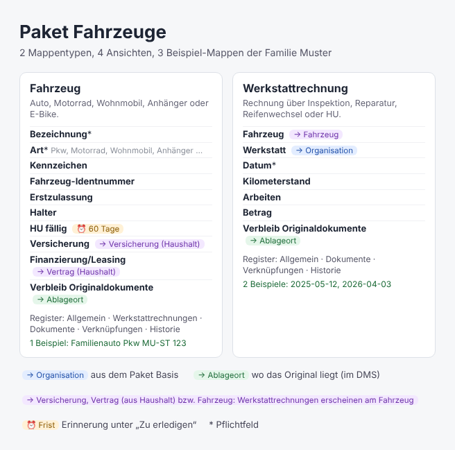

# Fahrzeuge

Das Paket **Fahrzeuge** bringt die Mappentypen **Fahrzeug** und **Werkstattrechnung**. Damit verpasst du die HU nicht, findest Fahrzeugbrief und Versicherung schnell und hast beim Verkauf alle Rechnungen beisammen. Installiert wird es unter **Werkbank → Pakete**; die Pakete **Basis** und **Haushalt** kommen dabei automatisch mit.

## Inhalt

| Mappentyp | wofür | wichtige Felder | Frist |
| --- | --- | --- | --- |
| Fahrzeug | Pkw, Motorrad, Wohnmobil, Anhänger, E-Bike | Bezeichnung, Art, Kennzeichen (eindeutig), Fahrzeug-Identnummer, Erstzulassung, Halter (Person), Versicherung, Finanzierung/Leasing | **HU fällig** (60 Tage vorher) |
| Werkstattrechnung | Inspektion, Reparatur, Reifenwechsel, HU | Fahrzeug, Werkstatt, Datum, Kilometerstand, Arbeiten, Betrag | – |

**Register:** Das **Fahrzeug** zeigt unter *Werkstattrechnungen* alle Rechnungen, die auf es verweisen; dazu *Dokumente*, *Verknüpfungen* und *Historie*. Eine Werkstattrechnung gehört zu ihrem Fahrzeug.

**Verweise:**

- **Versicherung** ist eine **Versicherung** und **Finanzierung/Leasing** ein **Vertrag** aus dem Paket Haushalt.
- **Werkstatt** ist eine **Organisation** aus dem Paket Basis.
- **Halter** ist eine **Person** aus dem Paket Basis (Verweisart Bezug). An der Person und an der Versicherung siehst du unter *Verknüpfungen*, welche Fahrzeuge auf sie verweisen.
- **Verbleib Originaldokumente** zeigt auf einen **Ablageort** des DMS – beim Fahrzeug der Fahrzeugbrief (Zulassungsbescheinigung Teil II), z. B. im Safe.

**Ansichten:** *Fahrzeuge* mit allem und darunter *Alle Fahrzeuge*, *Werkstattrechnungen* und *HU fällig* – Fahrzeuge, deren Hauptuntersuchung in den nächsten drei Monaten fällig oder schon überfällig ist.

**Beispiele (optional):** das Familienauto der Familie Muster und zwei Werkstattrechnungen. Die Rechnungen hängen am Auto, das Auto zeigt auf die Kfz-Versicherung und den Halter Tom Muster aus Haushalt (wenn deren Beispiele installiert sind). Werkstatt und Ablageort „Safe“ setzt du selbst.

## Voraussetzungen

- DMS ab Version 0.121 (Halter als Verweis, Umwandlung von Text in Verweise nach dem Update, Feldformate und Datumsgrenzen)
- Pakete **Basis** ab 1.1.0 (Person) und **Haushalt** ab 1.1.0 – werden bei der Installation aus dem Katalog mitinstalliert

## Rechte und Netz

Dieses Paket enthält keinen Code. Es legt nur Mappentypen, Ansichten und auf Wunsch Beispiel-Mappen an.

## Nach der Installation

1. Je Fahrzeug eine Mappe **Fahrzeug** anlegen und *HU fällig* von der Plakette übernehmen.
2. Die Kfz-Versicherung als **Versicherung** (Paket Haushalt) anlegen und am Fahrzeug auswählen.
3. Werkstattrechnungen als Mappe **Werkstattrechnung** ablegen, das Fahrzeug auswählen und die Rechnung als Dokument dazulegen.
4. Nach der HU das neue Datum eintragen – die Erinnerung erledigt sich dann von selbst.

Bestehende eigene Mappentypen ändert das Paket nicht. Ein Update ergänzt nur neue Felder, Register und Ansichten.

**Update von 1.0.x:** Der Halter war bis 1.0.x ein Textfeld. Das Update legt den Verweis dazu, der Text bleibt. Unter **Werkbank → Pakete → Fahrzeuge → Text in Verweise umwandeln** siehst du in einer Vorschau je Name, welche Person das DMS vorschlägt oder neu anlegt; erst dann wird umgewandelt. Das lässt sich rückgängig machen.

## Pflege

Fehler und Wünsche bitte als [Issue in dms-registry](https://github.com/motom001/dms-registry/issues) mit „Fahrzeuge“ im Titel.
